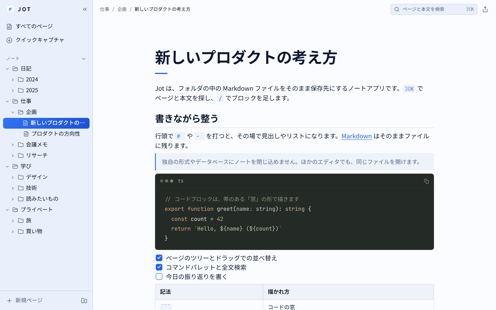
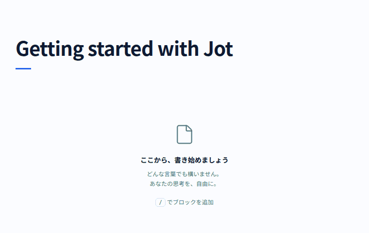
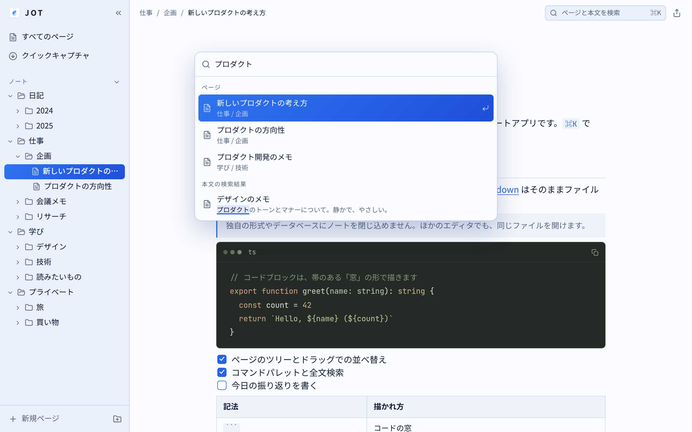

# Jot

A fast, local-first Markdown notes app. Your notes are plain `.md` files in a folder you choose — no database, no proprietary format.

Built with Tauri 2, React and Rust. Runs on macOS and Linux.

<picture>
  <source media="(prefers-color-scheme: dark)" srcset="docs/images/editor-dark.png">
  
</picture>

## Features

- **Plain Markdown files.** Point Jot at a folder and it reads and writes the `.md` files directly. Any other editor can open the same notes.
- **Block editor.** Type `# `, `- `, `[] ` or `> ` and the line becomes a heading, list, checklist or quote. Press `/` for the block menu.
- **Lossless saving.** Blocks you did not touch are written back byte-for-byte, so opening and saving a file never produces a diff.
- **Code blocks.** Syntax highlighting, a language picker and a copy button. `mermaid` blocks render as diagrams.
- **Command palette.** `⌘K` / `Ctrl+K` searches page titles, full text and commands from one input.
- **Page tree.** Nest pages and folders, and drag to reorganize. Links between pages are rewritten when you move things.
- **Quick capture.** A global hotkey opens a small window that appends to your inbox from any app.
- **Vim mode.** Optional Vim keybindings that keep working while a Japanese IME is on.





## Install

There are no prebuilt binaries yet. Build from source with [Node.js](https://nodejs.org/) and [Rust](https://www.rust-lang.org/tools/install):

```sh
git clone https://github.com/hina-kura49/jot.git
cd jot
npm install
```

**macOS**

```sh
npm run build:app   # → src-tauri/target/release/bundle/macos/Jot.app
```

**Linux (Ubuntu / GNOME)**

```sh
sudo apt install libwebkit2gtk-4.1-dev libgtk-3-dev libsoup-3.0-dev librsvg2-dev libayatana-appindicator3-dev libxdo-dev libssl-dev
npx tauri build --features core --no-bundle   # → src-tauri/target/release/jot
```

On first launch, pick the folder to use as your vault.

## Shortcuts

On Linux, read `⌘` as `Ctrl`.

| Key | Action |
| --- | --- |
| `⌘K` | Command palette |
| `/` | Block menu |
| `⌘F` | Find in page |
| `⌘N` / `⌘⇧N` | New page / new child page |
| `⌘⇧↑` / `⌘⇧↓` | Move block up / down |
| `⌘⇧H` | Export page as a single HTML file |
| `⌃⌥Space` | Quick capture (global) |

## Development

```sh
npm run dev     # dev server with mock data at http://localhost:5173
npm test        # unit tests (Vitest)
npm run lint    # oxlint
npm run app     # run the desktop app against mock data
```

The frontend lives in `src/` (React, TypeScript, Milkdown), the vault engine in `core/` (Rust), and the Tauri shell in `src-tauri/`.

More detail, currently in Japanese: [features](docs/features.md) · [Vim mode](docs/vim.md) · [development guide](docs/development.md).

The app UI is in Japanese for now.

## Contributing

Issues and pull requests are welcome. Please run `npm test` and `npm run lint` before opening a PR.

## License

[MIT](LICENSE). The bundled JetBrains Mono font is licensed under the [SIL Open Font License](src/assets/fonts/JetBrainsMono-LICENSE.txt).
